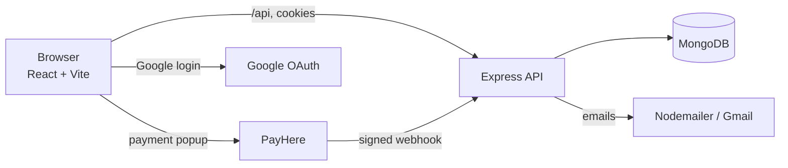

<div align="center">

# 🐠 Ornamental Fish Farm Store

**A secure, animated MERN e-commerce website for an ornamental fish farm in Sri Lanka.**


-0A66C2)

[Features](#-features) ·
[Screenshots](#-screenshots) ·
[Quick Start](#-quick-start) ·
[API](#-api-endpoints) ·
[Security](#-security) ·
[Deployment](#-deployment)

</div>

---

## 📖 About

The farm owner sells a small, carefully chosen set of ornamental fish directly to buyers. Stock is counted per fish, so a buyer can never order more than what is really available. Because buyers pay online, **security is the top priority** across the whole project.

The site has three kinds of users: **visitors** (browse only), **buyers** (cart, checkout, orders) and one **admin** (manages everything). Prices and totals are always calculated on the server, never trusted from the browser.

> **Status:** backend, frontend, buyer panel and admin panel are complete. Card payments run in PayHere **sandbox** mode.

---

## ✨ Features

### 🌊 For everyone (visitors)
- Full-screen **hero video** with animated headline and rising bubbles
- **Live fuzzy search** (Fuse.js) that still works when you misspell a fish name
- **3D tilt fish cards** with a liquid-glass look, floating drawn fish and a light that follows the mouse
- Fish details page: price, size, description, care tips and live stock
- Customer feedback, About page, Contact page, WhatsApp chat button
- Send feedback (named or anonymous) and send a request or problem
- Fully responsive, glass navigation bar, smooth scroll animations

### 🛒 For buyers
- Register and login with email and password, or with **Google**
- Strong password rules, "suggest strong password", show/hide and copy
- Cart saved per user in the browser
- Checkout with **Cash on Delivery** or **Card (PayHere)**
- Thank-you email after a successful order
- Order tracker: Pending → Confirmed → Shipped → Delivered (or Cancelled)
- Buyer panel: profile, change password, my orders, requests and replies

### 🛠 For the admin
- Dashboard: total orders, revenue, pending orders, low-stock fish
- Fish management: add, edit, delete, image upload, price and stock
- Order management: details, status updates, mark Cash on Delivery as paid
- Manage buyers, buyer requests (mark resolved) and feedback

---

## 📸 Screenshots

> Add your own screenshots to a `docs/` folder and replace the lines below.

| Home | Fish cards |
|---|---|
|  |  |

| Checkout | Admin panel |
|---|---|
|  |  |

---

## 🧱 Tech Stack

| Area | Technology |
|---|---|
| Frontend | React 18 (Vite), React Router 6, Tailwind CSS v4, Axios, Fuse.js, react-hot-toast |
| Animation | GSAP, ScrollTrigger, `@gsap/react` |
| Backend | Node.js, Express 4 |
| Database | MongoDB with Mongoose 8 (Atlas or local) |
| Auth | JWT in httpOnly cookies, bcrypt, Google OAuth |
| Email | Nodemailer |
| Payments | Cash on Delivery, PayHere (hosted checkout and JS popup, LKR) |
| Validation | zod, xss |
| Security | helmet, cors, express-rate-limit, express-mongo-sanitize |

### How the parts fit together



---

## 📁 Project Structure

```
fish-farm/
├── server/
│   ├── server.js                 App start, security middleware, routes
│   ├── seed.js                   Creates the admin user and 12 sample fish
│   ├── .env.example              Template for environment variables
│   ├── config/db.js              MongoDB connection
│   ├── models/                   User, Fish, Order, Request, Feedback
│   ├── middleware/               auth, validate, rateLimiter, upload, errorHandler
│   ├── controllers/              auth, fish, order, payment, card, user,
│   │                             request, feedback, admin, contact
│   ├── routes/                   One route file per controller
│   ├── utils/                    asyncHandler, generateToken, sendEmail,
│   │                             payhere, schemas, stock, mockGateway
│   ├── scripts/                  simulate-payhere.js (payment test helper)
│   └── uploads/                  Uploaded fish images
└── client/
    ├── public/hero-video.mp4     Hero background video (replace with your own)
    └── src/
        ├── main.jsx, App.jsx, index.css, config.js
        ├── lib/gsap.js           GSAP setup (plugins registered once)
        ├── api/                  axios.js (helpers), mockApi.js (demo mode)
        ├── context/              AuthContext, CartContext
        ├── components/           Navbar, Footer, FishCard, Reveal, SearchBar,
        │                         FeedbackList, PasswordInput, RequestForm,
        │                         CardPaymentForm, ProtectedRoute, Spinner
        │   ├── buyer/            MyOrders, BuyerProfile, BuyerRequests
        │   └── admin/            Dashboard, ManageFish, ManageOrders,
        │                         ManageBuyers, ManageRequests, ManageFeedback
        └── pages/                Home, MoreFish, FishDetails, Cart, Checkout,
                                  PaymentResult, BuyerPanel, AdminPanel,
                                  About, Contact, Login
```

---

## 🚀 Quick Start

### Requirements

- **Node.js 20 or newer** (`node -v`)
- A free [MongoDB Atlas](https://www.mongodb.com/atlas) cluster, or a local MongoDB
- Optional: Google OAuth client (Google login), Gmail App Password (emails), PayHere sandbox account (card payments)

### 1. Clone

```bash
git clone <your-repository-url>
cd fish-farm
```

### 2. Backend

```bash
cd server
npm install
cp .env.example .env        # Windows: copy .env.example .env
```

Open `.env` and fill in at least `MONGO_URI` and `JWT_SECRET`. To make a strong secret:

```bash
node -e "console.log(require('crypto').randomBytes(48).toString('hex'))"
```

> With MongoDB Atlas, add your IP in **Network Access** first, or the server cannot connect.

Add the sample data, then start the server:

```bash
npm run seed
npm run dev
```

You should see `MongoDB connected` and `Server running on port 5000`. Check `http://localhost:5000/api/health`.

### 3. Frontend

In a second terminal:

```bash
cd client
npm install
npm run dev
```

Open **http://localhost:5173**. In development the Vite proxy sends `/api` and `/uploads` to `http://localhost:5000`, so no API address is needed.

### 4. Make it yours

- Replace the hero video: `client/public/hero-video.mp4`
- Edit the farm name, address, phone, email and social links: `client/src/config.js`
- Log in as admin and add real fish with photos from the **Fish** tab

### Default admin (development only)

| Email | Password |
|---|---|
| value of `ADMIN_EMAIL` | value of `ADMIN_PASSWORD` |

Set your own values in `.env` before running `npm run seed`, and change them before real customers use the site.

---

## 🔐 Environment Variables

### `server/.env`

| Variable | Description |
|---|---|
| `PORT` | Server port (default `5000`) |
| `NODE_ENV` | `development` or `production` |
| `CLIENT_URL` | Frontend address, used for CORS and PayHere return links (`http://localhost:5173`) |
| `SERVER_URL` | Public backend address for the PayHere notify URL (use an ngrok address to test the webhook locally) |
| `MONGO_URI` | MongoDB connection string |
| `JWT_SECRET` | Long random text that signs login tokens |
| `JWT_EXPIRES_IN` | Token lifetime (default `7d`) |
| `GOOGLE_CLIENT_ID` | Google OAuth client ID (optional) |
| `EMAIL_HOST`, `EMAIL_PORT`, `EMAIL_USER`, `EMAIL_PASS`, `EMAIL_FROM` | Nodemailer settings. For Gmail use an **App Password**. If empty, emails are skipped and the app still works |
| `PAYHERE_MERCHANT_ID`, `PAYHERE_MERCHANT_SECRET` | PayHere credentials (the secret must belong to the registered domain) |
| `PAYHERE_SANDBOX` | `true` for testing, `false` for live payments |
| `ENABLE_TEST_CARD` | `true` turns on the **demo** card form. Never enable in production |
| `ADMIN_WHATSAPP_NUMBER` | Digits only, for example `94771234567` (WhatsApp button on the About page) |
| `ADMIN_EMAIL`, `ADMIN_PASSWORD` | Admin account made by `npm run seed`. Contact messages also go to `ADMIN_EMAIL` |

### `client/.env` (optional)

| Variable | Description |
|---|---|
| `VITE_API_URL` | Leave empty in development. In production set it to your API address plus `/api` |
| `VITE_GOOGLE_CLIENT_ID` | Google OAuth client ID. The Google button shows only when this is set |
| `VITE_TEST_CARD` | `true` shows the demo card form (must match `ENABLE_TEST_CARD`) |
| `VITE_MOCK` | `true` turns on demo mode (fake data, no backend) |

> **Never commit `.env` files.** They are in `.gitignore`. Only `.env.example` (with no real values) belongs in Git.

---

## 📜 Scripts

### Server (`/server`)

| Command | What it does |
|---|---|
| `npm run dev` | Start with auto-restart (nodemon) |
| `npm start` | Start normally (production) |
| `npm run seed` | Create the admin user and **replace all fish** with 12 samples |
| `node scripts/simulate-payhere.js <orderId> <amount> [statusCode]` | Send a signed fake PayHere notification |

### Client (`/client`)

| Command | What it does |
|---|---|
| `npm run dev` | Development server on port 5173 |
| `npm run build` | Production build |
| `npm run preview` | Preview the production build |

> ⚠️ `npm run seed` **deletes every fish** and adds the samples again with new IDs. Use it only while developing. Add real fish through the Admin Panel.

---

## 👥 User Roles

| Role | Can do |
|---|---|
| **Visitor** | Browse, search, view fish, read feedback, send feedback and requests. Cannot buy |
| **Buyer** | Everything a visitor can, plus cart, checkout, own orders, profile and requests |
| **Admin** | Manage fish, stock, orders, buyers, requests and feedback. Cannot buy |

Roles are checked on the **backend** for every protected route. The frontend route guards are only a convenience.

---

## 🔌 API Endpoints

All endpoints start with `/api`.

| Area | Endpoint | Access |
|---|---|---|
| **Auth** | `POST /auth/register`, `POST /auth/login`, `POST /auth/google` | Public |
| | `POST /auth/logout`, `GET /auth/me` | Logged in |
| **Fish** | `GET /fish` (`?limit=9`), `GET /fish/:id` | Public |
| | `POST /fish`, `PUT /fish/:id`, `DELETE /fish/:id` (image upload) | Admin |
| **Orders** | `POST /orders`, `GET /orders/my`, `PUT /orders/:id/cancel` | Buyer |
| | `GET /orders/:id` | Owner or admin |
| | `DELETE /orders/:id` | Buyer (own, finished orders) or admin |
| **Payments** | `POST /payments/payhere/start` | Buyer |
| | `POST /payments/payhere/notify` (webhook, signature checked) | PayHere only |
| **Profile** | `GET /users/profile`, `PUT /users/profile`, `PUT /users/change-password` | Buyer |
| **Requests** | `POST /requests` | Visitor or buyer |
| | `GET /requests/my` | Buyer |
| **Feedback** | `GET /feedback`, `POST /feedback` | Public |
| **Contact** | `POST /contact`, `GET /contact/info` | Public |
| **Admin** | `GET /admin/stats`, `/admin/orders`, `/admin/buyers`, `/admin/requests` | Admin |
| | `PUT /admin/orders/:id/status`, `PUT /admin/orders/:id/paid`, `PUT /admin/requests/:id/resolve`, `DELETE /admin/feedback/:id` | Admin |

---

## 💳 Payments

- **Cash on Delivery:** the order starts as `Pending`. The admin marks it **Paid** after delivery.
- **Card (PayHere):** the buyer pays in PayHere's own page or popup. Card details never touch this server or database.
  1. The order is created first, with status **Pending Payment**.
  2. The server builds the PayHere hash. The merchant secret never leaves the server.
  3. PayHere calls the `notify_url` webhook. The order becomes **Paid** only after the server checks the `md5sig` signature, the merchant ID, and that the amount and currency match.
  4. A repeated notification changes nothing (no double processing).
  5. Only the order ID, payment status, PayHere payment ID and amount are stored.

### PayHere sandbox checklist

- Register your domain (`localhost` for local testing) in the PayHere sandbox account
- Use the **Merchant Secret of that domain**, not another one
- Keep `PAYHERE_SANDBOX=true`
- PayHere cannot reach `localhost` for the webhook, so use ngrok or the simulate script below

### Test the webhook without ngrok

1. Create a card order as a buyer. Its status is `Pending Payment`.
2. In `server/` run:
   ```bash
   node scripts/simulate-payhere.js <orderId> <amount> 2
   ```
   Example: `node scripts/simulate-payhere.js 6710aa11bb22cc33dd44ee55 500.00 2` (status `2` means success).
3. The order becomes **Paid**.

### Test with a real sandbox payment (ngrok)

1. Run `ngrok http 5000` and copy the `https://...` address.
2. Put it in `SERVER_URL` in `server/.env` and restart the server.
3. Pay with a PayHere sandbox test card (see the PayHere documentation for current numbers).

### Demo card form (development only)

For classroom demos there is a built-in card form that works like a normal online checkout. It accepts only a few whitelisted **test** card numbers and never stores card data. Turn it on with `ENABLE_TEST_CARD=true` (server) and `VITE_TEST_CARD=true` (client). **Keep both off in production.**

### Going live

Use your live Merchant ID and Secret, set `PAYHERE_SANDBOX=false`, use a public HTTPS `SERVER_URL`, add your real domain in PayHere, and turn the demo card form off.

---

## 🛡 Security

| Area | What is done |
|---|---|
| Passwords | Hashed with bcrypt (cost 12), never stored in plain text |
| Sessions | JWT in `httpOnly`, `secure` (production) and `sameSite` cookies |
| Authorization | Role middleware on every protected route, plus ownership checks (buyers read and delete only their own orders) |
| Input | zod validation with unknown fields removed, XSS cleaning, `express-mongo-sanitize`, 10 KB body limit |
| Hardening | helmet headers, CORS limited to the frontend, rate limits (stricter on login, register and public forms), central error handler that leaks no internals |
| Orders | Prices and totals recalculated from the database, stock checked with an atomic update (no overselling), stock returned once on cancellation |
| Payments | Hosted checkout, server-side hash, verified webhook, no double processing, no card data stored |
| Uploads | Admin only, JPG/PNG/WEBP, 2 MB limit, random file names |
| Secrets | All in `.env`, which is git-ignored |

---

## ✅ Manual Testing Checklist

There is no automated test suite yet. Use Thunder Client or Postman:

1. `GET /api/fish` returns fish. `?limit=9` returns 9.
2. Register a buyer. A weak password is rejected. Sending `"role":"admin"` still creates a buyer.
3. Login, then `GET /api/auth/me` works. After logout it returns 401.
4. As a buyer, `POST /api/fish` returns 403. As admin it works with a valid image and rejects PDFs and files over 2 MB.
5. Create a COD order. Stock goes down. A quantity above stock is rejected. A changed `price` in the request is ignored.
6. Cancel the order. Stock goes back. A second cancel is rejected.
7. Another buyer cannot read your order (403).
8. Card order plus `simulate-payhere.js`: the order becomes Paid. Running it again changes nothing. A wrong amount is rejected.
9. Eleven wrong logins in a row are blocked (429).

---

## 🎬 Demo Mode (frontend only)

To look at the frontend without the backend or database, add this to `client/.env`:

```env
VITE_MOCK=true
```

Restart `npm run dev`. The site uses fake fish, feedback and logins (any email and password work, and an email containing `admin` gives an admin account). Nothing is saved, and card payments and admin editing need the real backend. Remove it (or set `false`) before deploying.

---

## 🎨 Animations

Animations use **GSAP** with ScrollTrigger. The plugins are registered once in `client/src/lib/gsap.js`.

- **Hero:** zooming video, word-by-word headline, scroll parallax, rising bubbles
- **Fish cards:** scroll entrance wave, smooth 3D tilt with `gsap.quickTo`, floating fish, add-to-cart bounce
- **Sections:** the reusable `<Reveal>` component fades blocks in on scroll (`stagger` for lists)
- **About and Contact:** staggered cards, sliding forms, floating icons

If a visitor has "reduce motion" turned on in their system, the animations are skipped and everything shows normally.

---

## 🌍 Deployment

- Serve both frontend and backend over **HTTPS** with `NODE_ENV=production`
- Set `CLIENT_URL` to the real website and `SERVER_URL` to the real API address
- On the client set `VITE_API_URL=https://your-api-domain/api`. The Vite proxy exists only in development, so your host must also route `/uploads` to the backend
- Behind a hosting proxy, add `app.set("trust proxy", 1)` in `server.js` so rate limiting sees real IP addresses
- Uploaded images live on the server disk. Many hosts wipe it on restart, so use persistent storage or a service such as Cloudinary
- In MongoDB Atlas, remove `0.0.0.0/0` from Network Access and allow only your server's IP
- Use **new** values for `JWT_SECRET`, the database password and `ADMIN_PASSWORD`. Never reuse values that were shared in chats or screenshots
- Switch PayHere to live, add your domain to the Google OAuth authorized origins, and turn the demo card form off

---

## ⚠️ Known Limitations

- An abandoned card order keeps its stock reserved until the buyer cancels it (an automatic cleanup after some minutes would fix this)
- If an admin cancels a **paid** card order, the refund must be made by hand in the PayHere dashboard
- The city sent to PayHere is fixed as "Colombo" because the checkout form has no city field
- Image uploads are checked by the file type the browser reports, not by reading the file contents (uploads are admin-only)
- A login token cannot be revoked on the server before it expires
- No CSRF token. If frontend and backend are on different domains, host them on the same site or add CSRF protection

## 🗺 Roadmap

- [ ] Email verification and forgot password
- [ ] Two-factor login for the admin
- [ ] Admin audit log
- [ ] Automatic cleanup of abandoned card orders
- [ ] Automated tests
- [ ] Tank and temperament fields for each fish
- [ ] Google Maps on the Contact page

---

## 🧰 Troubleshooting

| Problem | Fix |
|---|---|
| `Could not connect to any servers in your MongoDB Atlas cluster` | Add your IP in Atlas **Network Access**, check the cluster is not paused, and try another network (some campus Wi-Fi blocks MongoDB) |
| `bad auth` | Wrong username or password in `MONGO_URI` |
| `Route not found: /api/fish` | The route is not connected in `server.js` |
| `Cannot use import statement outside a module` | `"type": "module"` is missing in `package.json` |
| `Cannot find package '...'` | Run `npm install` in the right folder (`server` or `client`) |
| Page has no styling | Tailwind v4 needs `@import "tailwindcss";` in `index.css` and the `@tailwindcss/vite` plugin in `vite.config.js`. Restart `npm run dev` |
| Changes in `.env` do not apply | Stop the server (`Ctrl+C`) and start it again |
| `401` on every request | You are logged out. Log in again |
| `429 Too many attempts` | Rate limit reached. Wait 15 minutes or restart the server |
| Emails are not sent | Fill in the `EMAIL_...` variables (Gmail needs an App Password). Without them emails are skipped |
| The Google button is missing | Set `VITE_GOOGLE_CLIENT_ID` in `client/.env` and restart |
| PayHere "Unauthorized payment request" | Register the domain (`localhost`), use that domain's Merchant Secret, keep `PAYHERE_SANDBOX=true`, and restart the server |
| WhatsApp button missing on About | Set `ADMIN_WHATSAPP_NUMBER` (digits only, starting with `94`) and **restart the server** |
| Cannot find module `gsap` | Run `npm install gsap @gsap/react` inside `client` |

---

## 🤝 Contributing

1. Fork the repository and create a branch: `git checkout -b feature/my-change`
2. Commit your work: `git commit -m "Add my change"`
3. Push and open a pull request

Please never include `.env` files, passwords or API keys in a commit.

## 📄 License

Built for learning and for a real ornamental fish farm business. Add your own license here (for example MIT) if you plan to share the code.

## 👤 Author

**Milan**, third-year software engineering student, Sri Lanka.
